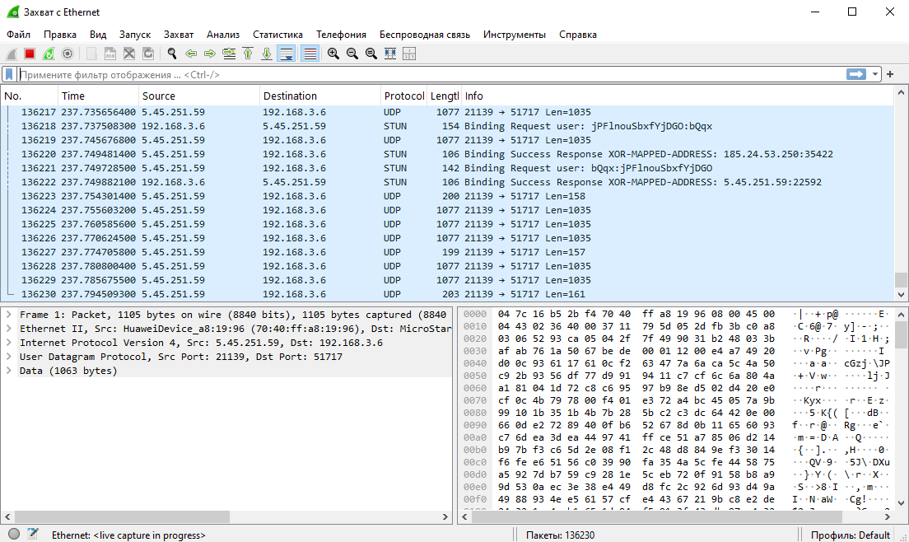

# Занятие 3. Анализ трафика в Wireshark

В работе рассматривается захват сетевого трафика с Ethernet-интерфейса и разбор пакетов в Wireshark.

На скриншоте видны обмен UDP-пакетами и сообщения STUN. Для выбранного пакета раскрыта структура: Ethernet II, IPv4, UDP и данные. В списке пакетов отображаются адреса отправителя и получателя, протокол, длина и дополнительная информация. Справа показано содержимое пакета в шестнадцатеричном виде.

## Материалы

- [homework_03.png](homework_03.png) — скриншот захвата и разбора пакета.

## Скриншоты

### Скриншот захвата и разбора пакета

## Что показывает работа

Разобрана структура пакета от Ethernet-кадра до UDP-данных. Скриншот иллюстрирует просмотр заголовков, адресов, портов и содержимого пакета в Wireshark.
