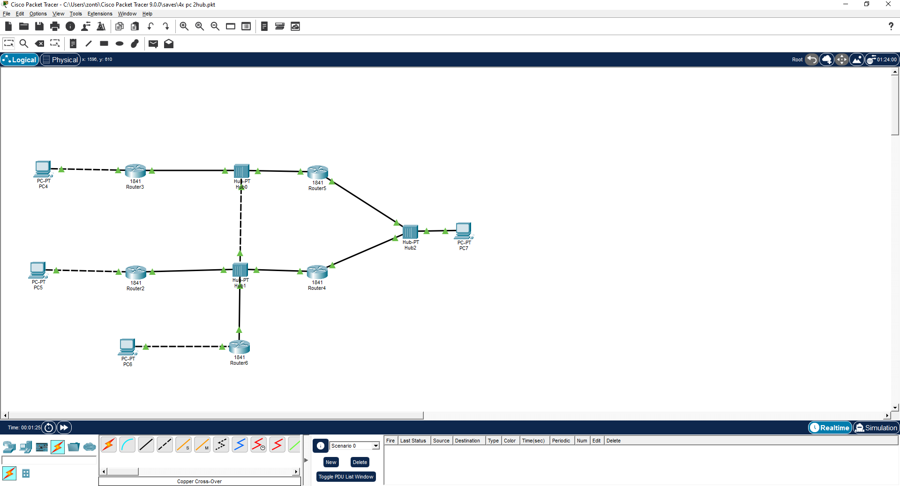
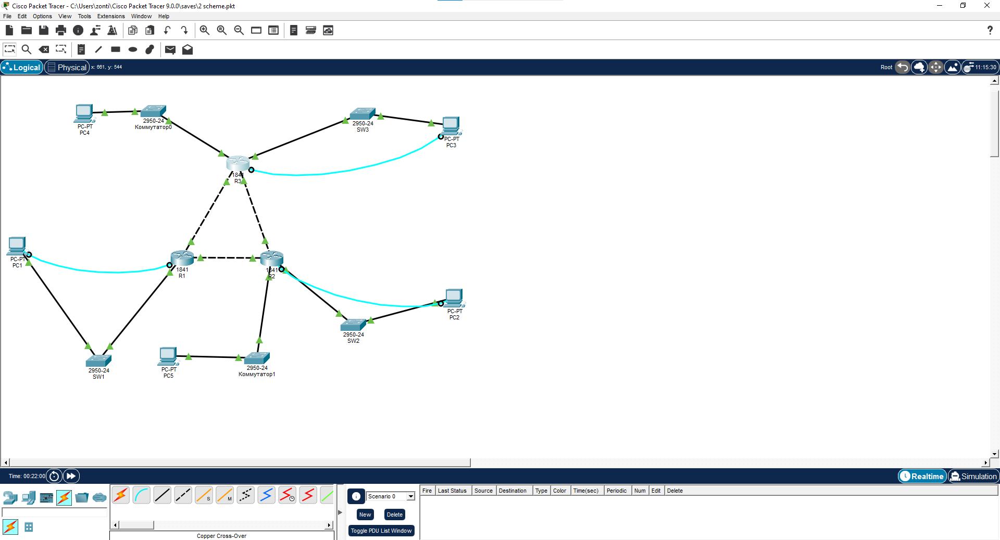
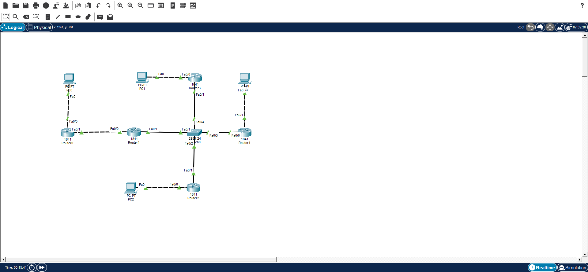

# Занятие 9. Топологии сети с маршрутизаторами

В ветке представлены три схемы, собранные в Cisco Packet Tracer.

## Схема 1

Четыре компьютера, пять маршрутизаторов 1841 и три концентратора. Маршрутизаторы связаны через общие сегменты с концентраторами.

## Схема 2

Три маршрутизатора соединены треугольником. К ним через пять коммутаторов подключены пять компьютеров. Голубым показаны консольные подключения для настройки устройств.

## Схема 3

Четыре компьютера, пять маршрутизаторов 1841 и один коммутатор 2950. Четыре маршрутизатора подключены к центральному коммутатору, а пятый соединён с одним из них напрямую.

## Вывод

Собраны три схемы с разным расположением устройств и соединений. На них показано, как компьютеры и маршрутизаторы можно объединить через концентраторы, коммутаторы и прямые подключения.

[Все занятия](https://github.com/Resolushh/Computer-networks/blob/main/README.md)

## Навигация

[Все занятия](https://github.com/Resolushh/Computer-networks/blob/main/README.md)

