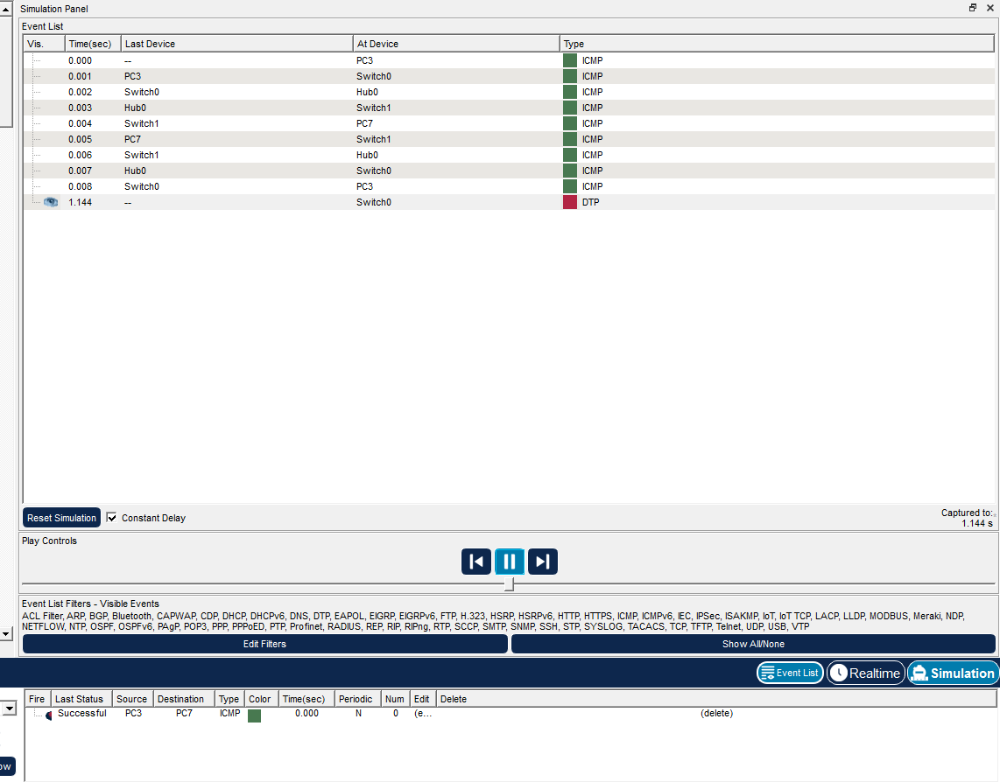

# Занятие 6. Проверка связи и прохождение ICMP

В Cisco Packet Tracer рассматривается локальная сеть из восьми компьютеров и двух коммутаторов 2960, соединённых через концентратор Hub0.

Связь проверяется командой `ping` и пошаговой симуляцией пакетов. На скриншоте командной строки PC5 запрос к `192.168.1.1` получает четыре ответа без потерь. В журнале Simulation показаны запрос ICMP от PC3 к PC7 и обратный ответ через Switch0, Hub0 и Switch1.

## Материалы

- [scheme.png](scheme.png) — схема соединений.
- [ping.png](ping.png) — результат проверки доступности.
- [simulation.png](simulation.png) — журнал прохождения пакетов.

## Скриншоты

### Схема соединений

### Результат проверки доступности

### Журнал прохождения пакетов

## Результат

Проверка ping завершилась без потерь: получены четыре ответа из четырёх. В режиме Simulation прослежен путь ICMP-запроса от PC3 к PC7 и ответного пакета через коммутаторы и концентратор.

## Навигация

[Все занятия](https://github.com/Resolushh/Computer-networks/blob/main/README.md)

