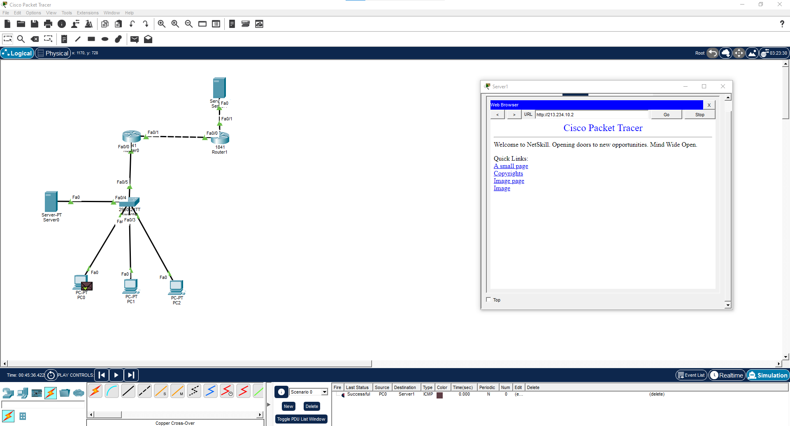

# Занятие 13. NAT и доступ к локальному веб-серверу

В Cisco Packet Tracer собрана сеть из трёх компьютеров, локального сервера, коммутатора 2960 и двух маршрутизаторов 1841. Второй маршрутизатор и внешний сервер имитируют сеть провайдера.

Работа посвящена трансляции адресов: PAT позволяет локальным узлам использовать общий внешний адрес, а статическое перенаправление TCP-порта обеспечивает доступ к локальному веб-серверу извне.

## Материалы

- [nat_network.png](nat_network.png) — топология, результат ICMP и открытая веб-страница.

## Скриншоты

### Топология, результат ICMP и открытая веб-страница

## Результат

На скриншоте передача ICMP от PC0 к Server1 отмечена как `Successful`. В браузере внешнего Server1 по адресу `http://213.234.10.2` открыта страница с текстом NetSkill.

Результат представлен схемой сети, успешной проверкой ICMP и открытой веб-страницей через внешний адрес маршрутизатора.

## Навигация

[Все занятия](https://github.com/Resolushh/Computer-networks/blob/main/README.md)

