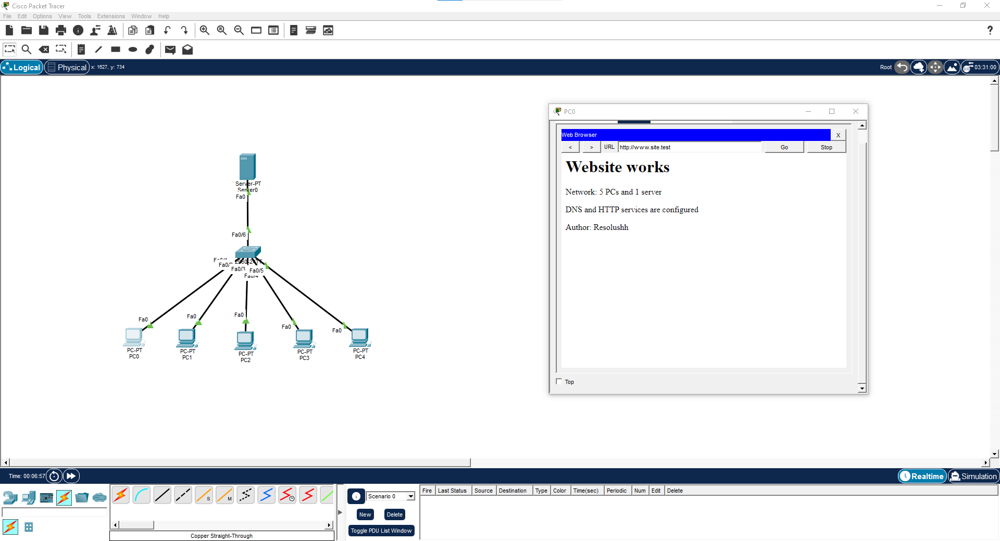
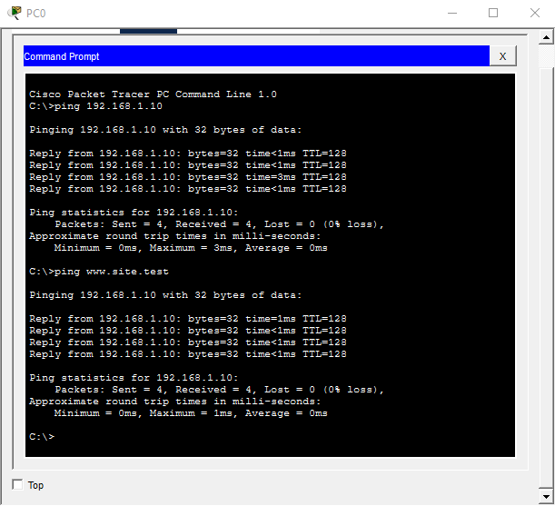

# Занятие 14. DNS и веб-сервер

**Задание:** построить сеть из пяти компьютеров и одного сервера с сайтом, настроить DNS и представить файл проекта и скриншоты в Git.

## Реализация

В Cisco Packet Tracer пять ПК и сервер подключены к коммутатору Cisco 2960. Сервер `192.168.1.10` обслуживает DNS и HTTP. Запись `www.site.test → 192.168.1.10` обеспечивает доступ к сайту по адресу `http://www.site.test`.

На PC0 сайт открывается по имени, а проверки `ping 192.168.1.10` и `ping www.site.test` проходят без потерь пакетов.

## Файлы

- [DNS_site.pkt](DNS_site.pkt) — схема и настройки сети; открыть в Cisco Packet Tracer.
- [scheme.png](scheme.png) — топология и открытый сайт.
- [ping.png](ping.png) — проверка связи по IP и доменному имени.

## Скриншоты

