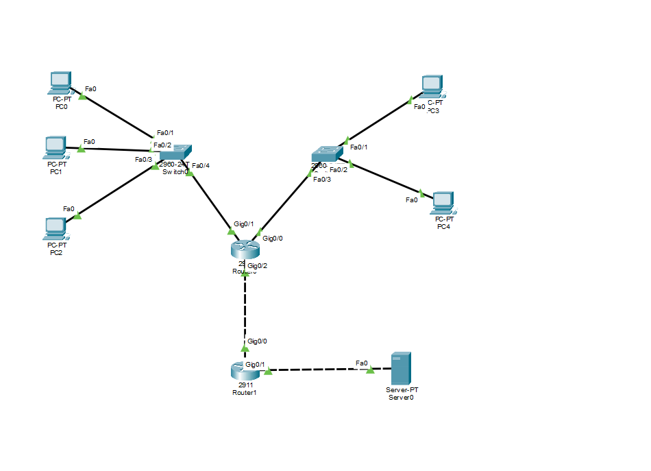

# Экзамен. Билет № 6

Практическая работа в Cisco Packet Tracer: построение сети из пяти компьютеров, двух коммутаторов, двух маршрутизаторов и сервера. Работа включает адресацию IPv4, настройку DHCP, маршрутизации, PAT, DNS и HTTP, а также проверку сетевого взаимодействия.

**Выполнил:** Зотов Владислав Сергеевич, группа РПО 9/25/3.

## Схема сети

Компьютеры распределены между подсетями `192.168.6.0/26` и `192.168.6.64/26`. Router0 выдаёт адреса по DHCP и выполняет PAT. Router1 обеспечивает соединение с сервером `203.0.113.10`, на котором работают DNS и HTTP.

## Материалы

- [Схема сети в Cisco Packet Tracer](bilet-6.pkt).
- [Отчёт по билету № 6](otchet.md) — адресация, настройка устройств, проверки и выводы.
- [Скриншоты](screenshots/) — схема сети, таблицы устройств и результаты проверок.

## Ход работы

- Рассчитаны две подсети с маской `/26` и настроены интерфейсы маршрутизаторов.
- На Router0 созданы пулы DHCP для обеих подсетей; все пять ПК получили сетевые настройки.
- Проверены ARP-таблица маршрутизатора и таблицы MAC-адресов коммутаторов.
- Настроены маршрут к серверной сети и преобразование адресов PAT.
- На сервере включены DNS и HTTP, добавлена A-запись `www.lab.test`.
- Выполнены проверки `ping`, `nslookup` и открытие сайта с клиентского ПК.
- В режиме Simulation рассмотрены получение адреса по DHCP и установление TCP-соединения.

## Итог

По результатам отчёта все пять компьютеров получили адреса, сервер доступен из обеих подсетей, DNS разрешает имя `www.lab.test`, а сайт открывается в браузере. Скриншоты в отчёте показывают работу DHCP, PAT и установление TCP-соединения.

## Весь курс

[← К оглавлению курса](https://github.com/Resolushh/Computer-networks/blob/main/README.md)
