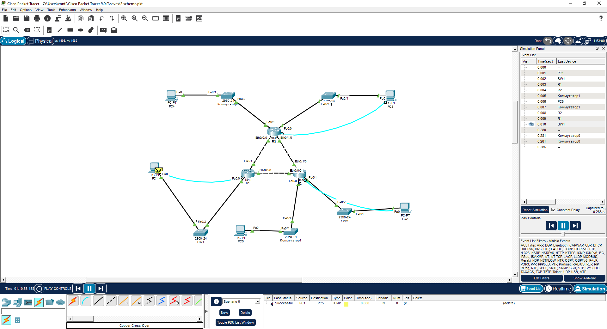

# Занятие 11. Маршрутизация RIP

В работе по теме RIP используется сеть Cisco Packet Tracer с тремя маршрутизаторами 1841, соединёнными треугольником. Через пять коммутаторов к ним подключены пять компьютеров.

На скриншоте открыт режим Simulation. В журнале показан проход ICMP от PC1 через SW1, R1 и R2 к PC5, затем ответ по обратному пути. В списке пользовательских пакетов этот обмен отмечен как `Successful`.

## Материалы

- [Cisco_RIP_scheme.png](Cisco_RIP_scheme.png) — топология и журнал успешной передачи ICMP.

## Скриншоты

### Топология и журнал успешной передачи ICMP

## Результат

Подтверждена связь PC1 и PC5 через маршрутизаторы R1 и R2. Журнал Simulation показывает прохождение ICMP-запроса и ответа, а статус `Successful` фиксирует успешный обмен.

[Все занятия](https://github.com/Resolushh/Computer-networks/blob/main/README.md)

