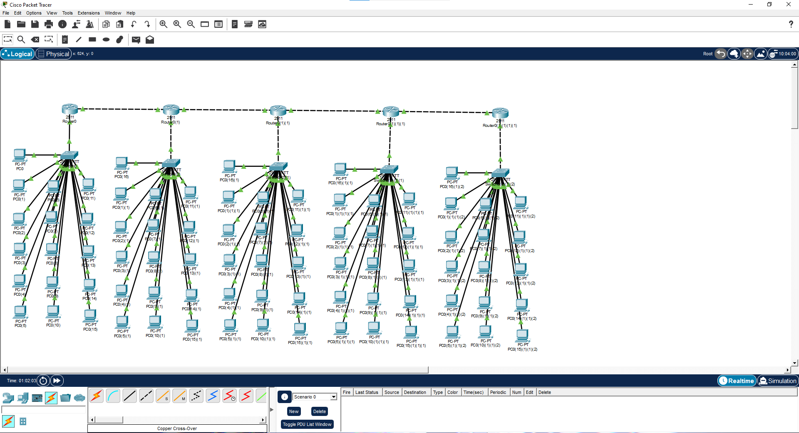

# Занятие 5. Подсети и построение сети

В работе рассматривается выбор маски для сети, где требуется не менее 20 подсетей и не менее 10 узлов в каждой, а также построение топологии в Cisco Packet Tracer.

В расчёте для количества подсетей выделено 5 бит: `2^5 = 32`. Для узлов выделено 4 бита: `2^4 - 2 = 14`. Получен префикс `/28` и маска `255.255.255.240`. Для такого распределения битов исходный префикс должен быть не длиннее `/23`.

## Материалы

- [homework_05.md](homework_05.md) — расчёт маски.
- [homework_05.png](homework_05.png) — топология с пятью маршрутизаторами, соединёнными в цепочку, и группами компьютеров через коммутаторы.

## Скриншоты

### Топология с пятью маршрутизаторами, соединёнными в цепочку, и группами компьютеров через коммутаторы

## Что показывает работа

Рассчитана маска `/28` с 14 доступными адресами устройств на подсеть. В Packet Tracer построена топология из пяти связанных маршрутизаторов и подключённых через коммутаторы групп компьютеров.

## Навигация

[Все занятия](https://github.com/Resolushh/Computer-networks/blob/main/README.md)

