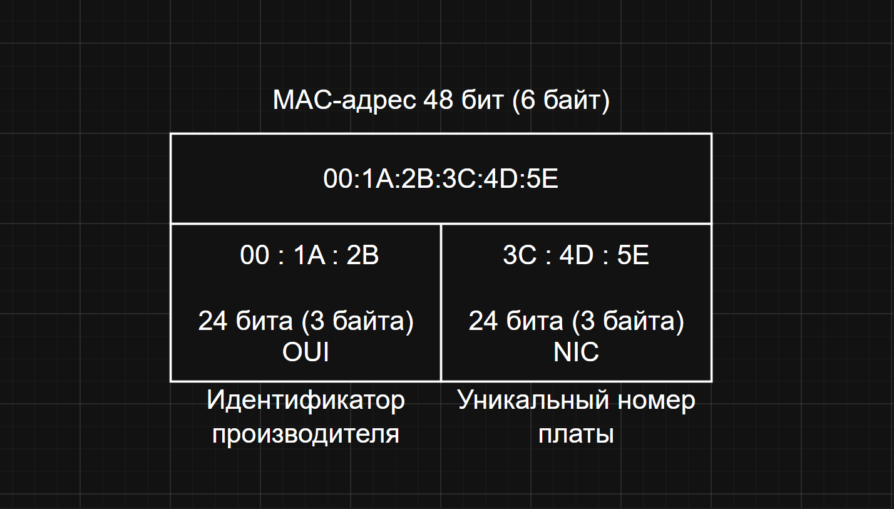
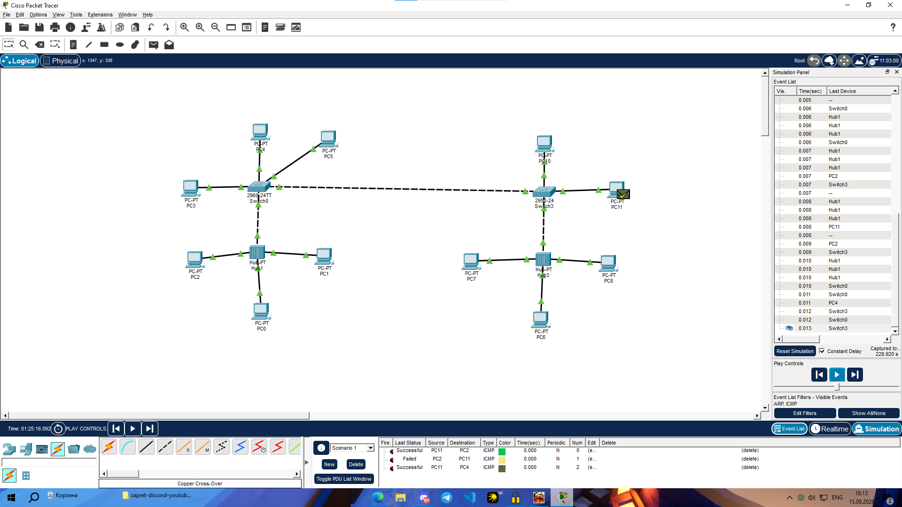

# Занятие 4. MAC-адреса и коммутация

В работе рассматриваются структура MAC-адреса и передача кадров в локальной сети с коммутаторами и концентраторами.

Схема MAC-адреса показывает 48-битную запись из шести байтов: первые три байта обозначены как OUI, последние три — как идентификатор устройства. В PDF приведены соответствия между четырьмя компьютерами, их учебными MAC-адресами и портами двух коммутаторов. Также перечислены возможные неисправности кабелей, портов и адресации.

## Материалы

- [MAC_scheme.png](MAC_scheme.png) — структура MAC-адреса.
- [homework_04.pdf](homework_04.pdf) — таблица адресов и разбор неисправностей.
- [switch_circuit.png](switch_circuit.png) — изображение схемы коммутаторов.
- [classwork.png](classwork.png) — сеть с коммутаторами и концентраторами в режиме Simulation.

## Скриншоты

### Структура MAC-адреса

### Изображение схемы коммутаторов

### Сеть с коммутаторами и концентраторами в режиме Simulation

## Что показывает работа

Материалы показывают структуру MAC-адреса, соответствие устройств портам коммутаторов и прохождение ICMP через локальную сеть. В журнале симуляции можно сравнить успешные и неудачную попытки передачи.

[Все занятия](https://github.com/Resolushh/Computer-networks/blob/main/README.md)

## Навигация

[Все занятия](https://github.com/Resolushh/Computer-networks/blob/main/README.md)

