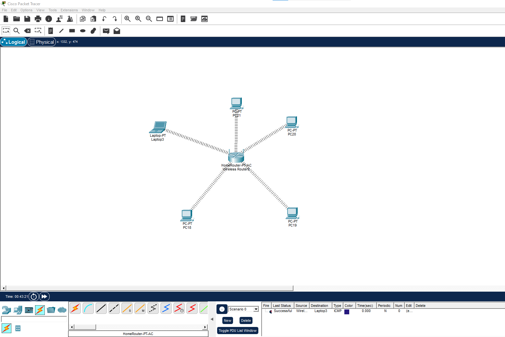
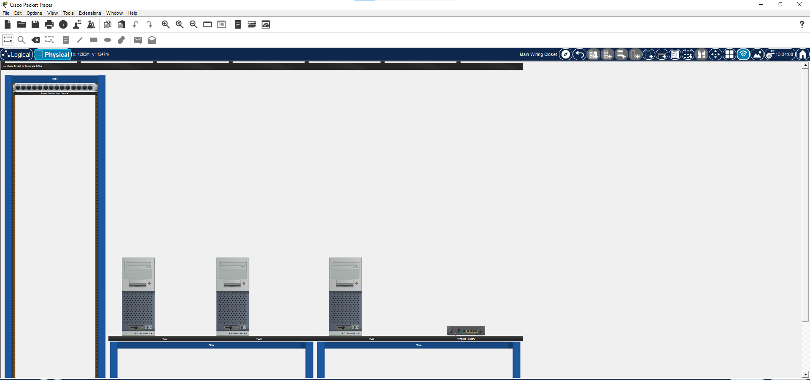
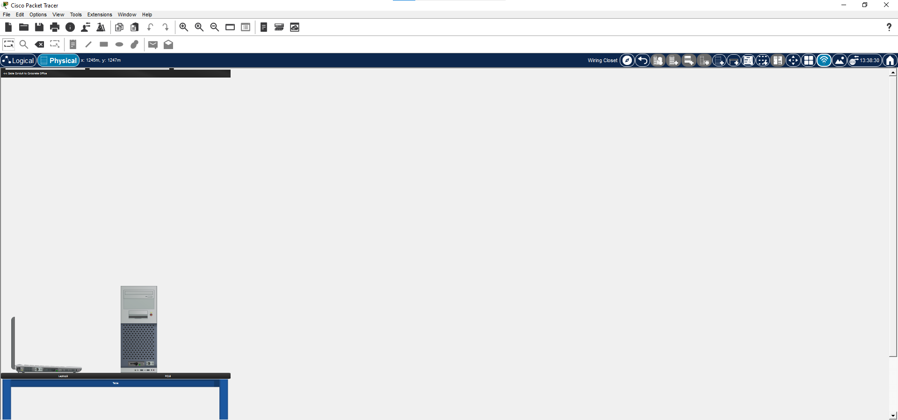

# Занятие 18. Практическая работа: настройка роутера

Настройте беспроводной роутер для работы с пятью компьютерами, расположенными в разных комнатах. Соберите схему в Cisco Packet Tracer и проверьте связь между устройствами.

## Схема сети

В логической схеме пять компьютеров подключены к беспроводному роутеру. В физическом режиме устройства размещены в разных комнатах.

## Задание

- Разместите беспроводной роутер и пять компьютеров в логической схеме.
- Настройте беспроводную сеть на роутере и подключите к ней все компьютеры.
- Настройте DHCP или задайте компьютерам статические адреса одной локальной сети.
- В физическом режиме Packet Tracer распределите компьютеры по разным комнатам и разместите роутер так, чтобы он обеспечивал связь с ними.
- Проверьте соединение каждого компьютера с роутером и обмен данными между компьютерами командой `ping`.

## Итог

Сохраните файл Packet Tracer с готовой схемой. Приложите скриншоты логической и физической схем, укажите параметры беспроводной сети и адресацию компьютеров, подтвердите успешную проверку связи.

## Весь курс

[← К оглавлению курса](https://github.com/Resolushh/Computer-networks/blob/main/README.md)
