# Отчет по билету 6

Зотов Владислав Сергеевич

Группа РПО 9/25/3

Билет 6

## Схема

Собрал сеть из пяти ПК, двух коммутаторов, двух роутеров и сервера. Router0 раздает адреса, Router1 соединяет его с сервером. Использованы встроенные порты.

Подключение устройств

## Адреса

Маска /26 равна 255.255.255.192. В подсети 64 адреса, из них 62 для устройств.

Левая сеть: 192.168.6.0/26, шлюз 192.168.6.1.

Правая сеть: 192.168.6.64/26, шлюз 192.168.6.65.

Между роутерами: Router0 198.51.100.1/30, Router1 198.51.100.2/30.

Сервер: 203.0.113.10/24, шлюз 203.0.113.1.

## DHCP

На Router0 настроил пулы LEFT и RIGHT. Они выдают адрес, маску, шлюз и DNS 203.0.113.10.

На всех ПК выбрал DHCP. На PC0 через ipconfig /all видны полученные настройки.

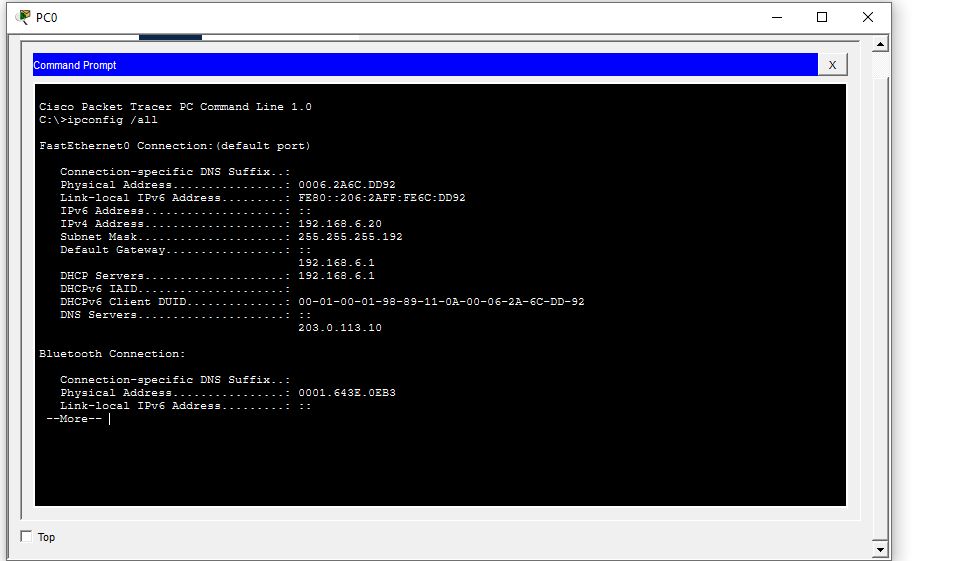

Настройки PC0

В show ip dhcp binding есть пять адресов: 192.168.6.20, .21, .22, .80 и .81.

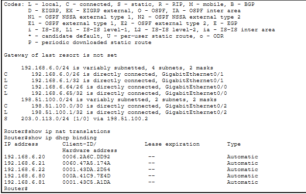

Выданные адреса

## ARP и коммутаторы

ARP находит MAC по IP в своей сети. На Router0 посмотрел таблицу через show ip arp.

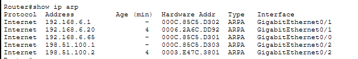

ARP таблица

На коммутаторах выполнил show mac address-table. В таблицах видны изученные MAC адреса и порты.

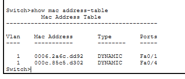

Switch0

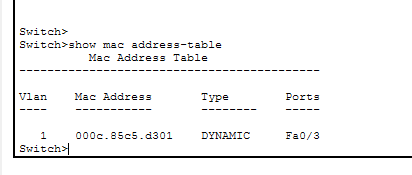

Switch1

## Маршрут и PAT

На Router0 добавил маршрут к 203.0.113.0/24 через 198.51.100.2.

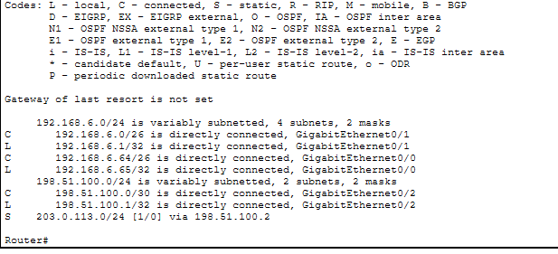

Маршрут к серверу

Ping с PC0 до шлюза и Router1 проходит без потерь. С Router1 сервер тоже отвечает.

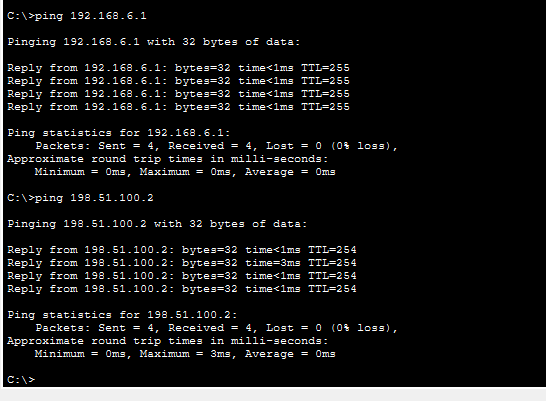

Ping с PC0

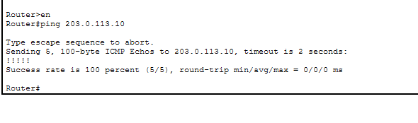

Ping с Router1

PAT на Router0 заменяет адреса клиентов общим адресом 198.51.100.1. Проверил через show ip nat translations.

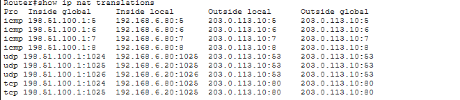

Таблица PAT

С PC3 шлюз и сервер отвечают без потерь.

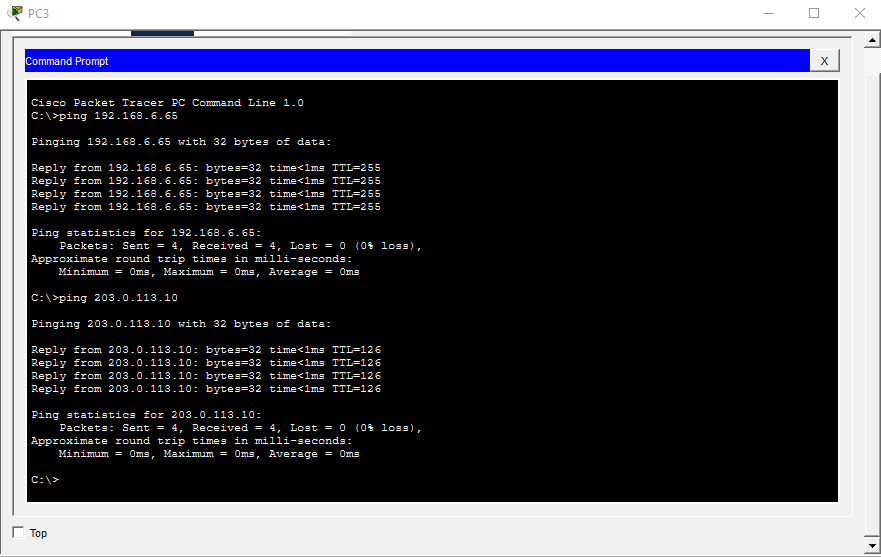

Ping с PC3

## DNS и сайт

На сервере включил DNS и HTTP. Добавил A запись www.lab.test для 203.0.113.10. Команда nslookup вернула нужный адрес. A связывает имя с IPv4 адресом.

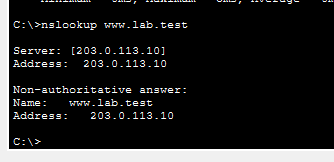

Проверка DNS

Сайт http://www.lab.test открылся на PC3.

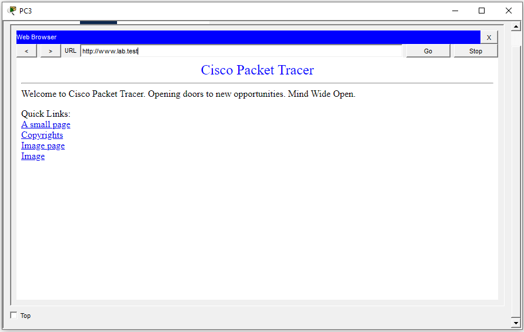

Страница сервера

## Проверка DHCP и TCP

В Simulation повторил получение адреса на PC4.

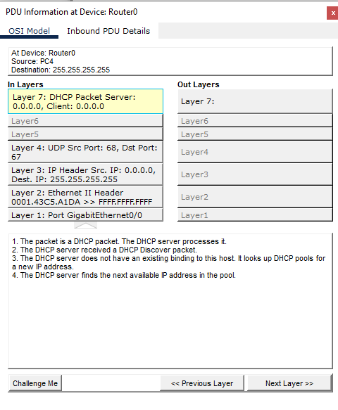

Клиент ищет DHCP сервер

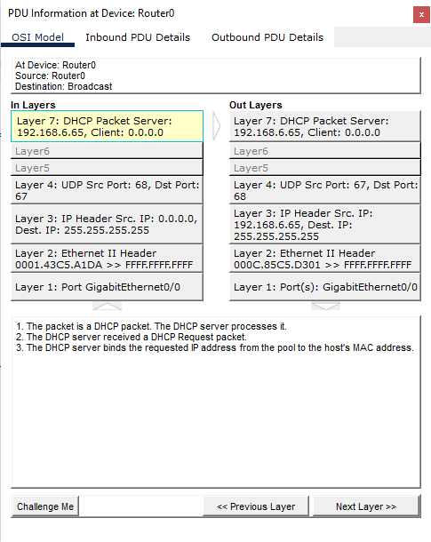

Клиент запрашивает адрес

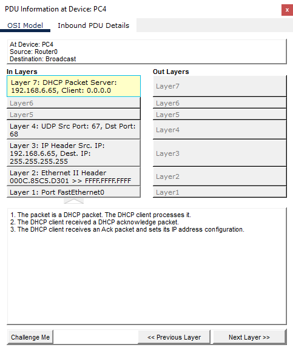

Клиент получил подтверждение

DHCP использует UDP: клиент порт 68, сервер порт 67.

При открытии сайта посмотрел TCP: клиент отправляет SYN, сервер отвечает SYN-ACK, клиент отправляет ACK.

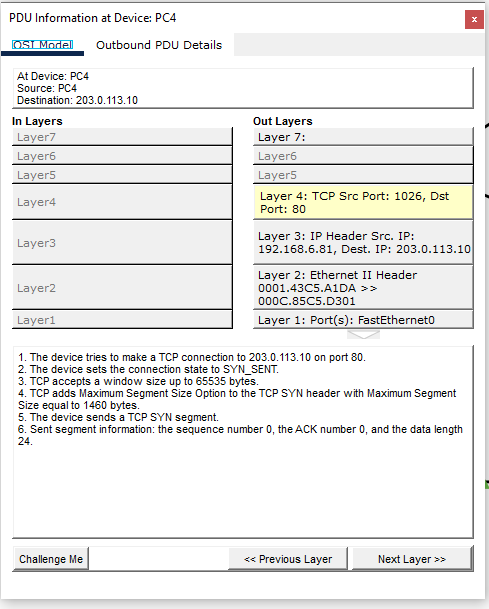

SYN от PC4

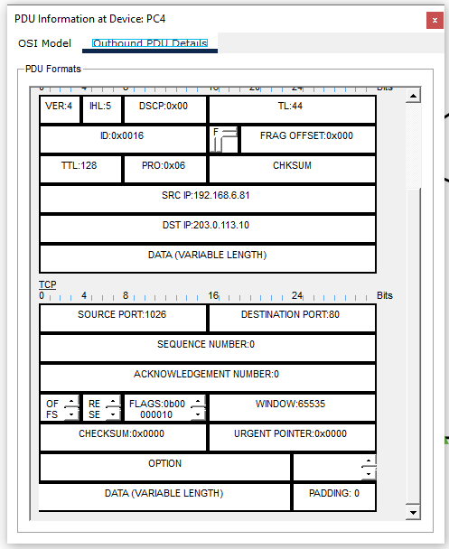

Флаг SYN

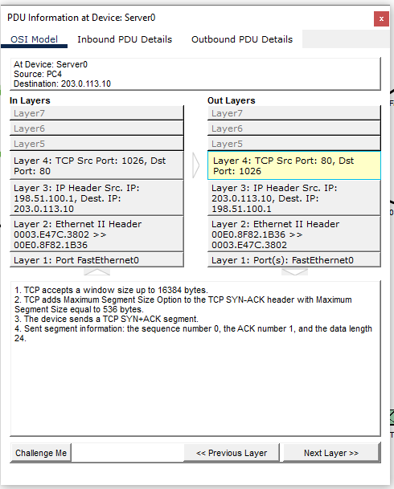

SYN-ACK от сервера

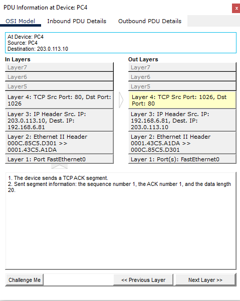

ACK от PC4

Netstat показал соединение с 203.0.113.10:80.

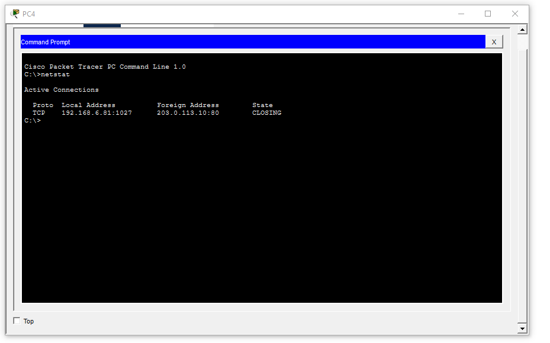

Результат netstat

## Вывод

Все пять ПК получили адреса. Сервер доступен из обеих подсетей, DNS отвечает и сайт открывается. DHCP работает через UDP 67 и 68, HTTP через TCP 80.

Данные идут от ПК через коммутатор и два роутера к серверу. На Router0 выполняется PAT. HTTP относится к прикладному уровню, TCP к транспортному, IP к сетевому, Ethernet к канальному.
